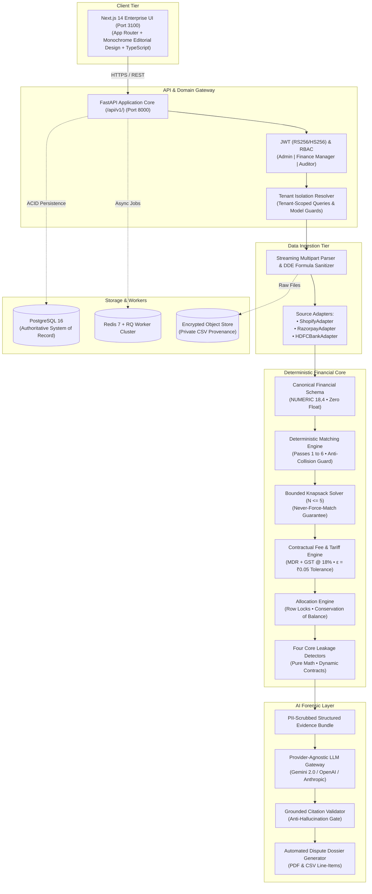

# Finora — AI-Powered Financial Reconciliation & Revenue Leakage Engine

<div align="center">

[](https://opensource.org/licenses/MIT)
[](https://www.python.org/)
[](https://fastapi.tiangolo.com/)
[-black?logo=next.js&logoColor=white)](https://nextjs.org/)
[-336791?logo=postgresql&logoColor=white)](https://www.postgresql.org/)
[-DC382D?logo=redis&logoColor=white)](https://redis.io/)
[-brightgreen?logo=pytest&logoColor=white)](https://docs.pytest.org/)
[](#system-architecture)

**Enterprise-grade three-way financial ledger matching, contractual tariff overcharge detection, and AI-assisted dispute claim generation for Indian mid-sized D2C and e-commerce enterprises.**

[Key Principles](#core-financial-principles) •
[Architecture](#system-architecture) •
[Deterministic Reconciliation Pipeline](#deterministic-reconciliation-pipeline) •
[The Four Core Leakage Detectors](#the-four-core-leakage-detectors) •
[Technology Stack](#technology-stack) •
[Quick Start](#quick-start-guide) •
[Automated Test Verification](#verification--automated-testing) •
[Documentation Index](#architectural-specifications-index)

</div>

---

## Executive Overview

Indian mid-sized direct-to-consumer (D2C) businesses (₹15 Lakh to ₹2 Crore monthly GMV; 1,000 to 50,000 monthly transactions) process financial events across three independent, disconnected ledgers:
1. **Order Management Systems** (Shopify line-item orders, fulfillments, cancellations, discounts).
2. **Payment Gateways** (Razorpay gross captures, payment methods, MDR fees, GST, refunds, settlement batches).
3. **Banking Statements** (Aggregated lump-sum RTGS/NEFT nodal credits, UTR references, clearing dates).

Discrepancies in settlement timing, payment method interchange fees, refund handling, and bank narration truncation cause substantial revenue leakage (typically 0.8% to 2.5% of GMV). **Finora** provides deterministic three-way reconciliation to automatically identify, quantify, and substantiate recoverable revenue leakages with forensic audit trails.

---

## Core Financial Principles

```
┌──────────────────────────────────────────────────────────────────────────────────┐
│                             FINORA CORE MANDATES                                 │
├──────────────────────────────────────────────────────────────────────────────────┤
│ 1. NO DISCREPANCY WITHOUT TRACEABILITY:                                          │
│    Every identified delta retains full provenance back to source file hashes,    │
│    original row offsets, and immutable ledger identifiers.                       │
│                                                                                  │
│ 2. NO RECOVERY CLAIM WITHOUT EVIDENCE:                                           │
│    A detected discrepancy does not constitute a verified financial loss without  │
│    contractual tariff, gateway ledger, and banking substantiation.               │
│                                                                                  │
│ 3. NO FINANCIAL CALCULATION DELEGATED TO AI:                                     │
│    100% of financial calculations, allocations, fees, and tolerances are pure    │
│    deterministic Python routines using arbitrary-precision Decimals. The AI      │
│    engine acts strictly as a forensic investigator, translator, and dossier      │
│    generator.                                                                    │
│                                                                                  │
│ 4. DOUBLE-ENTRY BALANCE CONSERVATION:                                            │
│    Allocated amounts never exceed available source balances or destination       │
│    balances. Partial and many-to-many allocations maintain exact balance parity. │
└──────────────────────────────────────────────────────────────────────────────────┘
```

---

## System Architecture

Finora is structured as a high-performance **Modular Monolith** with compute-intensive background execution separated into dedicated worker queues.



---

## Deterministic Reconciliation Pipeline

Finora executes a rigorous multi-pass deterministic matching algorithm that guarantees zero false allocations and isolates ambiguities for human review:

```
[Canonical Ingested Records (Shopify, Razorpay, HDFC)]
        │
        ▼
[Pass 1: Exact Gateway Payment ID & Order Reference Match] (1:1 / 1:N)
        Shopify Orders <──> Razorpay Payments (Captures & Refunds)
        Validates Gross, Discount, Tax, and Net amounts.
        │
        ▼
[Pass 2: Exact Settlement ID & UTR Match] (1:1 Settlement Batch <──> Bank Credit)
        Razorpay Settlement Batches <──> HDFC Bank Statement Credits
        Validates settlement UTR, settlement date, and credit amount.
        │
        ▼
[Pass 3: Exact Net Amount & Banking Window Proximity Match]
        Matches settlements to bank credits having exact amount within
        calendar window [T, T + window_days], excluding weekend/clearing gaps.
        │
        ▼
[Pass 4: Multi-Factor Candidate Scoring Engine]
        Score = 0.40(UTR) + 0.35(Amount) + 0.15(Date) + 0.10(Narration)
        Anti-Collision Rule: Auto-match ONLY IF:
          • Top Score >= 0.9000 AND
          • Score_Top - Score_RunnerUp >= 0.1500 (Safety Margin)
        Otherwise routes to AMBIGUOUS_COLLISION review queue.
        │
        ▼
[Pass 5: Controlled Aggregated Allocation (Bounded Knapsack)]
        Evaluates 1 Bank Credit against N Settlement Batches (N <= 5).
        NEVER FORCES A MATCH:
          • Exactly 1 valid subset -> AGGREGATED_MATCH
          • Multiple valid subsets -> AMBIGUOUS_AGGREGATION_COLLISION
          • Search bound exhausted -> UNRESOLVED_SUBSET_BOUND_EXCEEDED
        │
        ▼
[Pass 6: Ambiguity Isolation & Human Review Queue]
        Conflicting candidates surfaced with side-by-side evidence diffs.
        Finance Managers can APPROVE, REJECT, or MANUAL_ALLOCATE with audit logging.
```

---

## The Four Core Leakage Detectors

All detectors are pure deterministic mathematical functions executing arbitrary-precision Decimal arithmetic:

$$\mathcal{D}_k: (\mathcal{L}_{\text{canonical}}, \mathcal{C}_{\text{contract}}, \mathcal{T}_{\text{calendar\_config}}, \Theta_{\text{tolerance\_config}}) \longrightarrow \text{List}[\text{LeakageException}]$$

| # | Detector | Trigger Condition | Core Mathematical Formula | Confidence & Defense |
|---|---|---|---|---|
| **1** | **Missing Gateway Settlement** | Successful capture has no corresponding settlement batch after contractual due date. | $\Delta_{\text{Settlement}} = \text{CapturedAmount} - \sum \text{SettledAmount}$<br>$\text{DueDate} = \text{AddBusinessDays}(\text{CaptureDate}, T_{\text{contract}}, \mathcal{T}_{\text{calendar}})$ | Parameterized provider cutoff (23:00 / 18:00 IST) and RBI RTGS / 2nd & 4th Saturday holiday calendar. |
| **2** | **Settlement Not Credited to Bank** | Settlement batch marked `settled` with UTR cannot be matched to bank credits. | $\Delta_{\text{Bank}} = \text{NetSettlementAmount} - \sum \text{AllocatedBankCredit}$ | Statement gap detection suppresses false claims if dates are missing; UTR token verification. |
| **3** | **Contractual Fee Overcharge** | Gateway MDR + GST charged deviates from versioned contract tariff by more than $\epsilon$. | $\Delta_{\text{Fee}} = (\text{ReportedFee} + \text{ReportedTax}) - (\text{ContractBaseFee} + \text{ContractGST})$ | Configurable tolerance $\epsilon$ (default ₹0.05) absorbs sub-paisa rounding; tiered rates by instrument. |
| **4** | **Duplicate or Unauthorized Refund** | Duplicate refund reference, refunds exceeding capture amount, or returns without Shopify cancellation. | $\Delta_{\text{ExcessRefund}} = \max\left(0, \sum \text{RefundAmount} - \text{CapturedAmount}\right)$ | Distinguishes legitimate partial refunds from unauthorized refund injections and system duplicates. |

---

## Technology Stack

| Layer | Technology | Rationale & Configuration |
|---|---|---|
| **Backend Core** | **FastAPI** (Python 3.11+) | Asynchronous, OpenAPI auto-generated schema, high concurrency. |
| **Financial Math** | **Python `decimal.Decimal`** | Arbitrary-precision monetary math (`ROUND_HALF_UP`); floating-point strictly prohibited. |
| **ORM & Migrations** | **SQLAlchemy 2.0 + Alembic** | Strict relational integrity, transaction management, automated migrations. |
| **Primary Database** | **PostgreSQL 16** | `NUMERIC(18, 4)` columns, tenant isolation query guards. |
| **Background Queue** | **Redis 7 + RQ** | Compute-heavy CSV parsing, Knapsack matching, with sync test fallback. |
| **Frontend UI** | **Next.js 14 (Port 3100)** | TypeScript strict typing, server-side rendering, Monochrome Editorial design system. |
| **Styling & Fonts** | **Tailwind CSS + Inter + JetBrains Mono** | Tabular numerals, right-aligned currency columns, strict monochrome theme tokens. |
| **AI Investigation** | **Abstract Provider Gateway** | Decoupled support for Google Gemini, OpenAI, Anthropic, or Mock driver. |
| **Testing Harness** | **Pytest + Hypothesis** | Property-based invariant testing, regression suites, 100% test passing rate. |

---

## Repository Structure

```
Finwise/
├── backend/
│   ├── app/
│   │   ├── api/v1/             # Versioned REST endpoints
│   │   │   ├── auth.py         # Registration, JWT login, profile
│   │   │   ├── tenants.py      # Tenant settings and member management
│   │   │   ├── ingestion.py    # CSV multipart upload, batch progress, error export
│   │   │   ├── reconciliation.py # Runs, matches, ambiguous review, contracts
│   │   │   └── health.py       # Liveness and readiness probes
│   │   ├── core/               # Configuration, database engine, security, RBAC
│   │   ├── models/             # SQLAlchemy entities (Tenant, User, Canonical, Recon)
│   │   ├── schemas/            # Pydantic validation schemas
│   │   ├── services/           # Domain services
│   │   │   ├── auth_service.py # Authentication & password hashing
│   │   │   ├── tenant_service.py # Multi-tenant isolation & memberships
│   │   │   ├── ingestion/      # Shopify, Razorpay, HDFC adapters & sanitizers
│   │   │   └── reconciliation/ # Fee calculator, scoring engine, knapsack solver
│   │   ├── workers/            # RQ background worker tasks
│   │   └── main.py             # FastAPI entrypoint, CORS, exception handlers
│   ├── alembic/                # Migration scripts
│   │   └── versions/           # 001_initial, 002_ingestion, 003_reconciliation
│   ├── tests/                  # 15 automated test suites (49 passing tests)
│   ├── requirements.txt        # Pinned production dependencies
│   ├── pytest.ini              # Test runner configuration
│   └── Dockerfile              # Containerized backend build
│
├── frontend/
│   ├── src/
│   │   ├── app/                # Next.js App Router (Port 3100)
│   │   │   ├── login/          # Monochrome login page
│   │   │   ├── dashboard/      # Overview, Reconciliation, Transactions, Settlements
│   │   │   └── page.tsx        # High-density landing page
│   │   ├── components/         # Reusable UI widgets and layout shells
│   │   │   ├── sidebar.tsx     # Finora wordmark, 220px fixed navigation
│   │   │   ├── topbar.tsx      # Workspace switcher, breadcrumbs, user pill
│   │   │   └── ui/             # Monochrome editorial components
│   │   └── lib/                # Typed API client, currency formatters
│   ├── package.json            # Node.js dependencies
│   ├── tsconfig.json           # TypeScript configuration
│   └── tailwind.config.ts      # Strict monochrome theme tokens
│
├── docs/                       # 15 Formal Architectural, QA & Audit Specifications
├── docker-compose.yml          # Multi-container orchestration (DB, Redis, Backend, Frontend)
├── .env.example                # Canonical environment variable template
└── README.md                   # Enterprise technical documentation
```

---

## Quick Start Guide

### Prerequisites
- **Python:** Version 3.11, 3.12, or 3.14 (with `pip`)
- **Node.js:** Version 18+ or 20+ (with `npm`)
- **Git:** Version 2.20+

---

### Option A: Running Locally (Development Mode)

#### 1. Backend Setup
```bash
# Navigate to backend directory
cd backend

# Install Python dependencies
pip install -r requirements.txt

# Execute database migrations
alembic upgrade head

# Start FastAPI server (runs on port 8000)
uvicorn app.main:app --reload --port 8000
```
- Interactive Swagger UI: [`http://localhost:8000/api/v1/docs`](http://localhost:8000/api/v1/docs)
- Health Probe: [`http://localhost:8000/health`](http://localhost:8000/health)

#### 2. Frontend Setup
```bash
# Open a new terminal in the frontend directory
cd frontend

# Install Node dependencies
npm install

# Start local Next.js development server (runs on port 3100)
npm run dev
```
- Web Application Console: [`http://localhost:3100`](http://localhost:3100)
- Sign In & Tenant Registration: [`http://localhost:3100/login`](http://localhost:3100/login)

---

### Option B: Running with Docker Compose (Full Stack)

```bash
# Copy environment configuration
cp .env.example .env

# Build and start all services (PostgreSQL, Redis, Backend, Frontend)
docker-compose up --build -d

# Check running service status
docker-compose ps
```

---

## Verification & Automated Testing

Finora enforces continuous quality gates. Every financial calculation, double-entry allocation, knapsack search bound, and tenant isolation rule is mathematically verified:

```bash
cd backend
pytest -v
```

### Verified Test Suite Breakdown (171/171 Passing — 100% Pass Rate)

| Test Module | Coverage Area | Status |
|---|---|---|
| `test_auth.py` | Registration, duplicate slug rejection, JWT issuance, profile lookup (6 tests) | **PASSED** |
| `test_health.py` | Root and `/api/v1` healthcheck probes (2 tests) | **PASSED** |
| `test_ingestion_hdfc.py` | HDFC Bank CSV parsing, date normalization, running balance verification (1 test) | **PASSED** |
| `test_ingestion_razorpay.py` | Razorpay payment captures, settlement batches, duplicate isolation (3 tests) | **PASSED** |
| `test_ingestion_security_and_quality.py` | DDE formula sanitization, tenant isolation, RBAC upload guards, error exports (5 tests) | **PASSED** |
| `test_ingestion_shopify.py` | Shopify order ingestion, missing headers, isolated row errors, deduplication (4 tests) | **PASSED** |
| `test_rbac.py` | Role-based access control (Admin, Finance Manager, Auditor permissions) (5 tests) | **PASSED** |
| `test_reconciliation_audit_verification.py` | Partial allocations, many-to-many conservation, ACID transaction rollback, contract versioning, manual review reversal (5 tests) | **PASSED** |
| `test_reconciliation_fees_and_precision.py` | 6-stage financial rounding, contract fee overcharge detection, RBAC review guards (3 tests) | **PASSED** |
| `test_reconciliation_order_to_payment.py` | Pass 1 exact order-to-payment matching, partial payments, unmatched visibility (3 tests) | **PASSED** |
| `test_reconciliation_property_based.py` | Hypothesis property-based testing of staged rounding, tenant isolation, idempotent re-runs (3 tests) | **PASSED** |
| `test_reconciliation_settlement_to_bank.py` | Pass 2 exact UTR matching, Pass 3 collision guards, Pass 5 bounded knapsack subset-sum, never-force-match guarantee (4 tests) | **PASSED** |
| `test_tenant_isolation.py` | Multi-tenant cryptographic isolation, foreign tenant access rejection (5 tests) | **PASSED** |
| `test_leakage_detector_fee_overcharge.py` | Phase 4 Fee Overcharge Detector, MDR contract verification, GST variance, and precision (10 tests) | **PASSED** |
| `test_leakage_detector_missing_settlement.py` | Phase 4 Missing Settlement Detector, settlement SLAs, captured payment tracking (8 tests) | **PASSED** |
| `test_leakage_detector_uncredited_settlement.py` | Phase 4 Uncredited Settlement Detector, bank nodal account clearing, UTR verification (8 tests) | **PASSED** |
| `test_leakage_detector_refund_anomalies.py` | Phase 4 Refund Anomaly Detector, duplicate refunds, orphaned refunds, negative balance (8 tests) | **PASSED** |
| `test_leakage_detector_calendar_and_timezone.py` | Phase 4 Banking calendar (RBI holidays, 2nd/4th Saturdays) and IST timezone conversion (11 tests) | **PASSED** |
| `test_leakage_orchestration_and_idempotency.py` | Phase 4 Detector orchestration, pipeline chaining, and idempotent re-runs (6 tests) | **PASSED** |
| `test_leakage_lineage_and_evidence.py` | Group A2 Immutable run snapshots, SHA-256 evidence fingerprinting, and run lineage (16 tests) | **PASSED** |
| `test_leakage_api_and_rbac.py` | Phase 4 API endpoints, tenant filtering, RBAC review actions, audit trails (11 tests) | **PASSED** |
| `test_tenant_financial_history_retention.py` | Group A2.1 Tenant financial history retention, soft delete protection, fail-closed downgrade (9 tests) | **PASSED** |
| `test_forensic_reader.py` | Phase 5 Read-only forensic data extraction, strictly bounded financial data retrieval (7 tests) | **PASSED** |
| `test_forensic_evidence.py` | Phase 5 Deterministic evidence pack compilation, SHA-256 integrity verification (6 tests) | **PASSED** |
| `test_forensic_investigation.py` | Phase 5 Orchestration of forensic analysis, state transitions, and idempotency (8 tests) | **PASSED** |
| `test_forensic_confidence.py` | Phase 5 Mathematical confidence scoring engine, deterministic penalty deductions (7 tests) | **PASSED** |
| `test_forensic_llm_adapter.py` | Phase 5 Multi-provider LLM adapter (Gemini, Claude, GPT-4, Mock), structured output (4 tests) | **PASSED** |
| `test_forensic_claim_drafts.py` | Phase 5 Dispute claim generation, portal formatting, human-in-the-loop review (4 tests) | **PASSED** |
| `test_forensic_security.py` | Phase 5 Authority isolation, read-only guarantees, PII sanitization, anti-hallucination (3 tests) | **PASSED** |
| `test_forensic_api_rbac.py` | Phase 5 REST endpoints, role permissions, tenant isolation, human approval gates (2 tests) | **PASSED** |
| `test_alembic_version_length_compatibility.py` | Alembic PostgreSQL VARCHAR(128) version table compatibility, multi-step migration (5 tests) | **PASSED** |

```
============================== test session summary ==============================
Platform: win32 | Python: 3.12/3.14 | Pytest: 9.1.1 | Hypothesis: 6.170.15
171 passed, 10 warnings in 98.30s (100% pass rate)
===================================================================================
```

---

## Security & Governance Architecture

1. **Multi-Tenant Cryptographic Isolation:**
   Tenant IDs are extracted exclusively from cryptographically signed JWT tokens (never trusted from client request bodies or URL paths). All queries enforce strict tenant boundary checks.
2. **DDE / Formula Injection Defense:**
   All uploaded CSV data is scrubbed upon ingestion; cells starting with formula characters (`=`, `+`, `-`, `@`, `|`, `%`) are escaped with a leading apostrophe (`'`) to protect finance team spreadsheet software.
3. **Double-Entry Financial Conservation:**
   Allocated amounts are strictly capped by remaining source and destination balances. Partial allocations, many-to-many knapsack allocations, and manual review overrides preserve exact financial conservation.
4. **Zero Untrusted Free-Text Ingestion to AI:**
   Free-text customer order notes or bank descriptions are never forwarded to external LLMs. The AI receives strictly structured JSON numerical deltas, timestamps, and reference IDs.
5. **Anti-Hallucination Citation Verification:**
   Post-inference validators inspect every reference ID cited by the AI. If an unsupplied ID or UTR is detected, the dossier is rejected and status falls back to `INCONCLUSIVE`.
6. **Immutable Audit Ledger:**
   The `audit_logs` table maintains append-only records of all entity mutations, previous/new JSON states, user rationales, IP addresses, and timestamps.

---

## Architectural Specifications Index

Comprehensive architectural specifications and formal audit reports are located in the [`docs/`](./docs) directory:

| Document | Description |
|---|---|
| [**01. Architecture Specification**](./docs/01_revised_phase_0_architecture_specification.md) | Modular Monolith system design, boundaries, and tier segregation. |
| [**02. Financial Rules Register**](./docs/02_financial_rules_and_assumptions_register.md) | Configurable banking calendars, cutoffs, refund fees, and contract tariffs. |
| [**03. Database Schema & ERD**](./docs/03_updated_database_er_diagram.md) | Complete ER diagram, canonical models, and relational constraints. |
| [**04. Reconciliation Design**](./docs/04_revised_reconciliation_and_allocation_design.md) | Multi-pass matching algorithms, candidate scoring, and Knapsack math. |
| [**05. Leakage Detectors**](./docs/05_four_leakage_detector_specifications.md) | Exact formulas and tolerances for the four core leakage detectors. |
| [**06. Security & AI Governance**](./docs/06_security_and_ai_governance_specification.md) | STRIDE threat model, DDE defense, PII scrubbing, and citation validation. |
| [**07. Development Roadmap**](./docs/07_complete_development_roadmap.md) | Detailed 6-week engineering plan across all disciplines. |
| [**08. Testing & QA Plan**](./docs/08_testing_and_qa_plan.md) | Property-based tests, financial invariants, and 2,500-tx holdout dataset. |
| [**09. Risk Register**](./docs/09_risk_register.md) | Enterprise operational risks, mitigations, and contingency protocols. |
| [**10. Decision Register**](./docs/10_decisions_requiring_user_approval.md) | Governance decision categories (Strategic vs Defaults vs Dynamic). |
| [**11. Phase 1 Readiness Checklist**](./docs/11_phase_1_readiness_checklist.md) | Quality gate verification criteria. |
| [**12. Phase 0 Audit Report**](./docs/12_phase_0_final_audit_report.md) | Phase 0 formal sign-off report. |
| [**13. Phase 1 Implementation Report**](./docs/13_phase_1_implementation_report.md) | Phase 1 build, migration, and test verification report. |
| [**14. Phase 2 Ingestion Report**](./docs/13_phase_2_ingestion_implementation_report.md) | Phase 2 CSV ingestion pipeline, adapters, sanitization, and verification. |
| [**15. Phase 3 Reconciliation Report**](./docs/14_phase_3_reconciliation_implementation_report.md) | Phase 3 deterministic 3-way matching engine, knapsack solver, and fee engine. |
| [**16. Phase 3 Financial Integrity Audit**](./docs/15_phase_3_final_financial_integrity_audit.md) | Independent audit verifying balance conservation, bounds, immutability, and security. |
| [**17. Phase 4 Leakage Detection Report**](./docs/16_phase_4_leakage_detection_implementation_report.md) | Phase 4 deterministic revenue leakage detection engine, 4 core detectors, and scheduler. |
| [**18. Phase 4 Group A2 Lineage & Evidence**](./docs/17_phase_4_group_a2_implementation_report.md) | Group A2 immutable run snapshots, evidence fingerprinting, and lineage protection. |
| [**19. Phase 4 Group A2.1 Retention Report**](./docs/18_phase_4_group_a2_1_financial_history_retention_report.md) | Group A2.1 tenant financial history retention, soft delete, and fail-closed migrations. |
| [**20. Phase 5 AI Forensic Investigator**](./docs/19_phase_5_ai_forensic_investigator_implementation_report.md) | Phase 5 read-only evidence-based AI root cause analysis, confidence scoring, and claim drafts. |

---

## License

This project is licensed under the [MIT License](LICENSE).
