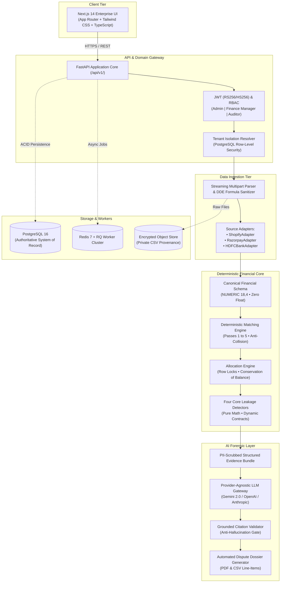

# Finora — AI-Powered Financial Reconciliation & Revenue Leakage Engine

<div align="center">

[](https://opensource.org/licenses/MIT)
[](https://www.python.org/)
[](https://fastapi.tiangolo.com/)
[-black?logo=next.js&logoColor=white)](https://nextjs.org/)
[-336791?logo=postgresql&logoColor=white)](https://www.postgresql.org/)
[-DC382D?logo=redis&logoColor=white)](https://redis.io/)
[-brightgreen?logo=pytest&logoColor=white)](https://docs.pytest.org/)
[](#system-architecture)

**Enterprise-grade three-way financial ledger matching, contractual tariff overcharge detection, and AI-assisted dispute claim generation for Indian mid-sized D2C and e-commerce enterprises.**

[Key Principles](#core-financial-principles) •
[Architecture](#system-architecture) •
[Leakage Detectors](#the-four-core-leakage-detectors) •
[Reconciliation Pipeline](#deterministic-reconciliation-pipeline) •
[Quick Start](#quick-start-guide) •
[Documentation](#architectural-specifications-index)

</div>

---

## Executive Overview

Indian mid-sized D2C businesses (₹15 Lakh to ₹2 Crore monthly GMV; 1,000 to 50,000 monthly transactions) process financial events across three independent, disconnected ledgers:
1. **Order Management Systems** (Shopify line-item orders, fulfillments, cancellations).
2. **Payment Gateways** (Razorpay gross captures, payment methods, MDR fees, GST, refunds, settlement batches).
3. **Banking Statements** (Aggregated lump-sum RTGS/NEFT nodal credits, UTR references, clearing dates).

Discrepancies in settlement timing, payment method interchange fees, refund handling, and bank narration truncation cause substantial revenue leakage (typically 0.8% to 2.5% of GMV). **Finora** provides deterministic three-way reconciliation to automatically identify, quantify, and substantiate recoverable revenue leakages with forensic audit trails.

---

## Core Financial Principles

```
┌──────────────────────────────────────────────────────────────────────────────────┐
│                             FINORA CORE MANDATES                                 │
├──────────────────────────────────────────────────────────────────────────────────┤
│ 1. NO DISCREPANCY WITHOUT TRACEABILITY:                                          │
│    Every identified delta retains full provenance back to source file hashes,    │
│    original row offsets, and immutable ledger identifiers.                       │
│                                                                                  │
│ 2. NO RECOVERY CLAIM WITHOUT EVIDENCE:                                           │
│    A detected discrepancy does not constitute a verified financial loss without  │
│    contractual tariff, gateway ledger, and banking substantiation.               │
│                                                                                  │
│ 3. NO FINANCIAL CALCULATION DELEGATED TO AI:                                     │
│    100% of financial calculations, allocations, fees, and tolerances are pure    │
│    deterministic Python routines using arbitrary-precision Decimals. The AI      │
│    engine acts strictly as a forensic investigator, translator, and dossier      │
│    generator.                                                                    │
└──────────────────────────────────────────────────────────────────────────────────┘
```

---

## System Architecture

Finora is structured as a high-performance **Modular Monolith** with compute-intensive background execution separated into dedicated worker queues.



---

## The Four Core Leakage Detectors

All detectors are pure deterministic mathematical functions:
$$\mathcal{D}_k: (\mathcal{L}_{\text{canonical}}, \mathcal{C}_{\text{contract}}, \mathcal{T}_{\text{calendar\_config}}, \Theta_{\text{tolerance\_config}}) \longrightarrow \text{List}[\text{LeakageException}]$$

| # | Detector | Trigger Condition | Core Mathematical Formula | Confidence & Defense |
|---|---|---|---|---|
| **1** | **Missing Gateway Settlement** | Successful capture has no corresponding settlement batch after contractual due date. | $\Delta_{\text{Settlement}} = \text{CapturedAmount} - \sum \text{SettledAmount}$<br>$\text{DueDate} = \text{AddBusinessDays}(\text{CaptureDate}, T_{\text{contract}}, \mathcal{T}_{\text{calendar}})$ | Parameterized provider cutoff (23:00 / 18:00 IST) and RBI RTGS / 2nd & 4th Saturday holiday calendar. |
| **2** | **Settlement Not Credited to Bank** | Settlement batch marked `settled` with UTR cannot be matched to bank credits. | $\Delta_{\text{Bank}} = \text{NetSettlementAmount} - \sum \text{AllocatedBankCredit}$ | Statement gap detection suppresses false claims if dates are missing; UTR token verification. |
| **3** | **Contractual Fee Overcharge** | Gateway MDR + GST charged deviates from versioned contract tariff by more than $\epsilon$. | $\Delta_{\text{Fee}} = (\text{ReportedFee} + \text{ReportedTax}) - (\text{ContractBaseFee} + \text{ContractGST})$ | Configurable tolerance $\epsilon$ (default ₹0.05) absorbs sub-paisa rounding; tiered rates by instrument. |
| **4** | **Duplicate or Unauthorized Refund** | Duplicate refund reference, refunds exceeding capture amount, or returns without Shopify cancellation. | $\Delta_{\text{ExcessRefund}} = \max\left(0, \sum \text{RefundAmount} - \text{CapturedAmount}\right)$ | Distinguishes legitimate partial refunds from unauthorized refund injections and system duplicates. |

---

## Deterministic Reconciliation Pipeline

```
[Raw Ingested Records]
        │
        ▼
[Pass 1: Exact Gateway Payment ID & Order Reference Match] (1:1 / 1:N)
        │
        ▼
[Pass 2: Exact Settlement ID & UTR Match] (1:1 Settlement Batch <──> Bank Credit)
        │
        ▼
[Pass 3: Exact Net Amount & Banking Window Proximity Match] (Net Match within [T, T + window])
        │
        ▼
[Pass 4: Multi-Factor Candidate Scoring Engine]
        Score = 0.40(UTR) + 0.35(Amount) + 0.15(Date) + 0.10(Narration)
        Anti-Collision Rule: Auto-match ONLY IF Score >= 0.90 AND Delta to Candidate #2 >= 0.15
        │
        ▼
[Pass 5: Controlled Aggregated Allocation (Bounded Knapsack)]
        Matches 1 Bank Credit to N Batches (N <= 5).
        NEVER FORCES A MATCH: Unresolved subsets transition to UNRESOLVED_SUBSET_BOUND_EXCEEDED.
        │
        ▼
[Pass 6: Ambiguity Isolation & Human Review Queue]
        Conflicting candidates surfaced with side-by-side evidence diffs for manual approval.
```

---

## Technology Stack

| Layer | Technology | Rationale & Configuration |
|---|---|---|
| **Backend Core** | **FastAPI** (Python 3.11+) | Asynchronous, OpenAPI auto-generated schema, high concurrency. |
| **Financial Math** | **Python `decimal.Decimal`** | Arbitrary-precision monetary math; floating-point strictly prohibited. |
| **ORM & Migrations** | **SQLAlchemy 2.0 + Alembic** | Strict relational integrity, transaction management, automated migrations. |
| **Primary Database** | **PostgreSQL 16** | `NUMERIC(18, 4)` columns, Row-Level Security (RLS) tenant isolation. |
| **Background Queue** | **Redis 7 + RQ** | Compute-heavy CSV parsing and Knapsack execution with sync test fallback. |
| **Frontend UI** | **Next.js 14 (App Router)** | TypeScript strict typing, server-side rendering, responsive dark enterprise UI. |
| **Styling & Icons** | **Tailwind CSS + Lucide Icons** | Charcoal-navy palette (`#090d16`), high-density financial tables. |
| **AI Investigation** | **Abstract Provider Gateway** | Decoupled support for Google Gemini, OpenAI, Anthropic, or Mock driver. |
| **Testing Harness** | **Pytest + Hypothesis** | Property-based invariant testing, regression suites, 100% test passing rate. |

---

## Repository Structure

```
Finwise/
├── backend/
│   ├── app/
│   │   ├── api/v1/             # Versioned REST endpoints (auth, tenants, users)
│   │   ├── core/               # App configuration, database engine, security, RBAC
│   │   ├── models/             # SQLAlchemy entities (Tenant, User, Membership, AuditLog)
│   │   ├── schemas/            # Pydantic validation schemas
│   │   ├── services/           # Business domain services (AuthService, TenantService)
│   │   ├── workers/            # RQ background worker queue dispatcher
│   │   └── main.py             # FastAPI entrypoint, CORS, healthcheck probes
│   ├── alembic/                # Migration scripts (001_initial_phase1_models.py)
│   ├── tests/                  # Pytest automated test suite (18 tests passing)
│   ├── requirements.txt        # Pinned production dependencies
│   ├── pytest.ini              # Test runner configuration
│   └── Dockerfile              # Containerized backend build
│
├── frontend/
│   ├── src/
│   │   ├── app/                # Next.js App Router (Landing, Login, Dashboard)
│   │   ├── components/         # Reusable UI widgets and layout shells
│   │   └── lib/                # Typed API client (ApiClient), formatting utilities
│   ├── package.json            # Node.js dependencies
│   ├── tsconfig.json           # TypeScript configuration
│   ├── tailwind.config.ts      # Enterprise theme tokens
│   └── postcss.config.js       # CSS post-processing
│
├── docs/                       # 13 Formal Architectural & QA Specifications
├── docker-compose.yml          # Multi-container orchestration (DB, Redis, Backend, Frontend)
├── .env.example                # Canonical environment variable template
└── README.md                   # Enterprise technical documentation
```

---

## Quick Start Guide

### Prerequisites
- **Python:** Version 3.11, 3.12, or 3.14 (with `pip`)
- **Node.js:** Version 18+ or 20+ (with `npm`)
- **Git:** Version 2.20+

### Option A: Running Locally (Development Mode)

#### 1. Backend Setup
```bash
# Navigate to backend directory
cd backend

# Install Python dependencies
pip install -r requirements.txt

# Execute initial database migrations
alembic upgrade head

# Start FastAPI server (runs on port 8000)
uvicorn app.main:app --reload --port 8000
```
- Interactive Swagger UI: [`http://localhost:8000/api/v1/docs`](http://localhost:8000/api/v1/docs)
- Health Probe: [`http://localhost:8000/health`](http://localhost:8000/health)

#### 2. Frontend Setup
```bash
# Open a new terminal in the frontend directory
cd frontend

# Install Node dependencies
npm install

# Start local Next.js development server (runs on port 3100)
npm run dev
```
- Web Application Console: [`http://localhost:3100`](http://localhost:3100)
- Sign In & Tenant Registration: [`http://localhost:3100/login`](http://localhost:3100/login)

---

### Option B: Running with Docker Compose (Full Stack)

```bash
# Copy environment configuration
cp .env.example .env

# Build and start all services (PostgreSQL, Redis, Backend, Frontend)
docker-compose up --build -d

# Check running service status
docker-compose ps
```

---

## Verification & Automated Testing

Finora enforces continuous quality gates. Financial calculations must be mathematically verified before any feature is marked complete.

```bash
cd backend
pytest -v
```

### Verified Test Suite Breakdown (18/18 Passing)
```
tests/test_auth.py
  ✓ test_register_new_tenant_and_user_success        PASSED [ 5%]
  ✓ test_register_duplicate_email_rejected           PASSED [11%]
  ✓ test_register_duplicate_slug_rejected            PASSED [16%]
  ✓ test_login_success                               PASSED [22%]
  ✓ test_login_invalid_password                      PASSED [27%]
  ✓ test_get_current_user_profile                    PASSED [33%]

tests/test_health.py
  ✓ test_healthcheck_root                            PASSED [38%]
  ✓ test_healthcheck_api_v1                          PASSED [44%]

tests/test_rbac.py
  ✓ test_auditor_cannot_update_tenant_settings       PASSED [50%]
  ✓ test_finance_manager_cannot_update_core_settings PASSED [55%]
  ✓ test_auditor_cannot_add_members                  PASSED [61%]
  ✓ test_auditor_can_view_members                    PASSED [66%]
  ✓ test_admin_can_update_settings_and_add_members   PASSED [72%]

tests/test_tenant_isolation.py
  ✓ test_tenant_isolation_cannot_access_foreign      PASSED [77%]
  ✓ test_tenant_isolation_cannot_update_settings     PASSED [83%]
  ✓ test_tenant_isolation_cannot_add_members         PASSED [88%]
  ✓ test_tenant_isolation_cannot_list_members        PASSED [94%]
  ✓ test_legitimate_tenant_access_succeeds           PASSED [100%]

======================== 18 passed in 9.14s ========================
```

---

## Security & Governance Architecture

1. **Multi-Tenant Isolation (PostgreSQL RLS):**
   Tenant IDs are extracted exclusively from cryptographically signed JWT tokens (never trusted from client request bodies or URL paths). Queries enforce tenant boundary checks at the database engine level.
2. **DDE / Formula Injection Defense:**
   All uploaded CSV data is scrubbed upon ingestion; cells starting with formula characters (`=`, `+`, `-`, `@`, `|`, `%`) are escaped with a leading apostrophe (`'`) to protect finance team spreadsheet software.
3. **Zero Untrusted Free-Text Ingestion to AI:**
   Free-text customer order notes or bank descriptions are never forwarded to external LLMs. The AI receives strictly structured JSON numerical deltas, timestamps, and reference IDs.
4. **Anti-Hallucination Citation Verification:**
   Post-inference validators inspect every reference ID cited by the AI. If an unsupplied ID or UTR is detected, the dossier is rejected and status falls back to `INCONCLUSIVE`.
5. **Immutable Audit Ledger:**
   The `audit_logs` table maintains append-only records of all entity mutations, previous/new JSON states, user rationales, IP addresses, and timestamps.

---

## Architectural Specifications Index

Comprehensive architectural specifications are located in the [`docs/`](./docs) directory:

| Document | Description |
|---|---|
| [**01. Architecture Specification**](./docs/01_revised_phase_0_architecture_specification.md) | Modular Monolith system design, boundaries, and tier segregation. |
| [**02. Financial Rules Register**](./docs/02_financial_rules_and_assumptions_register.md) | Configurable banking calendars, cutoffs, refund fees, and contract tariffs. |
| [**03. Database Schema & ERD**](./docs/03_updated_database_er_diagram.md) | Complete ER diagram, canonical models, and relational constraints. |
| [**04. Reconciliation Design**](./docs/04_revised_reconciliation_and_allocation_design.md) | Multi-pass matching algorithms, candidate scoring, and Knapsack math. |
| [**05. Leakage Detectors**](./docs/05_four_leakage_detector_specifications.md) | Exact formulas and tolerances for the four core leakage detectors. |
| [**06. Security & AI Governance**](./docs/06_security_and_ai_governance_specification.md) | STRIDE threat model, DDE defense, PII scrubbing, and citation validation. |
| [**07. Development Roadmap**](./docs/07_complete_development_roadmap.md) | Detailed 6-week engineering plan across all disciplines. |
| [**08. Testing & QA Plan**](./docs/08_testing_and_qa_plan.md) | Property-based tests, financial invariants, and 2,500-tx holdout dataset. |
| [**09. Risk Register**](./docs/09_risk_register.md) | Enterprise operational risks, mitigations, and contingency protocols. |
| [**10. Decision Register**](./docs/10_decisions_requiring_user_approval.md) | Governance decision categories (Strategic vs Defaults vs Dynamic). |
| [**11. Phase 1 Readiness Checklist**](./docs/11_phase_1_readiness_checklist.md) | Quality gate verification criteria. |
| [**12. Phase 0 Audit Report**](./docs/12_phase_0_final_audit_report.md) | Phase 0 formal sign-off report. |
| [**13. Phase 1 Audit Report**](./docs/13_phase_1_implementation_report.md) | Phase 1 build, migration, and test verification report. |

---

## License

This project is licensed under the [MIT License](LICENSE).
