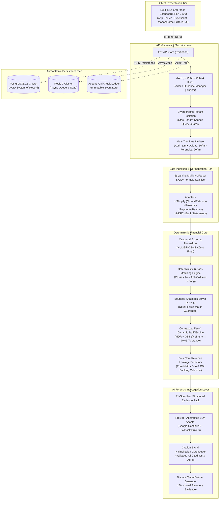

# Finora — AI-Powered Financial Reconciliation & Revenue Leakage Engine

<div align="center">

[](https://opensource.org/licenses/MIT)
[](https://www.python.org/)
[](https://fastapi.tiangolo.com/)
[-black?logo=next.js&logoColor=white)](https://nextjs.org/)
[-336791?logo=postgresql&logoColor=white)](https://www.postgresql.org/)
[-DC382D?logo=redis&logoColor=white)](https://redis.io/)
[](https://docs.pytest.org/)
[](#system-architecture)

**Enterprise-grade three-way financial ledger matching, contractual tariff overcharge detection, and evidence-backed dispute claim generation for Indian D2C and high-volume e-commerce enterprises.**

[Executive Overview](#executive-overview) •
[Core Principles](#core-financial-principles) •
[Architecture](#system-architecture) •
[Reconciliation Pipeline](#deterministic-reconciliation-pipeline) •
[Leakage Detectors](#the-four-core-leakage-detectors) •
[Technology Stack](#technology-stack) •
[Quick Start](#quick-start-guide) •
[Automated Verification](#verification--automated-testing) •
[Documentation](#documentation--production-readiness)

</div>

---

## Executive Overview

Indian direct-to-consumer (D2C) brands and multi-channel e-commerce merchants (₹15 Lakh to ₹50 Crore monthly GMV; 1,000 to 250,000+ monthly orders) process financial transactions across three independent, disconnected ledgers:

1. **Order Management Systems (OMS):** Shopify/WooCommerce line-item orders, fulfillments, discounts, cancellations, and customer refunds.
2. **Payment Gateways (PG):** Razorpay, Cashfree, or Pine Labs gross captures, payment method interchange fees (MDR), GST (18%), and aggregated nodal settlements.
3. **Banking Statements:** Corporate nodal and current accounts (HDFC, ICICI, Axis) with lump-sum RTGS/NEFT batch credits, truncated narration strings, and clearing date lags.

Discrepancies in settlement timing, gateway interchange overcharges, untracked refunds, and bank nodal narration truncation lead to an average **0.8% to 2.4% revenue leakage** against top-line GMV.

**Finora** provides deterministic, double-entry three-way reconciliation to automatically ingest, normalize, match, and detect recoverable revenue leakages with tamper-evident audit trails and grounded AI forensic investigation dossiers.

---

## Core Financial Principles

```
┌────────────────────────────────────────────────────────────────────────────────────────┐
│                              FINORA FINANCIAL INVARIANTS                               │
├────────────────────────────────────────────────────────────────────────────────────────┤
│ 1. ZERO FLOATING-POINT ARITHMETIC:                                                     │
│    100% of financial calculations use arbitrary-precision Python Decimal (ROUND_HALF_UP)│
│    persisted in PostgreSQL as NUMERIC(18, 4). Native floats are strictly prohibited.   │
│                                                                                        │
│ 2. DOUBLE-ENTRY BALANCE CONSERVATION:                                                  │
│    Allocated amounts never exceed remaining source or destination balances.            │
│    Partial and many-to-many allocations maintain exact balance parity at all times.    │
│                                                                                        │
│ 3. STRICT READ-ONLY AI BOUNDARIES:                                                     │
│    No financial calculation, fee computation, or reconciliation decision is ever       │
│    delegated to an LLM. AI models act exclusively as forensic evidence synthesizers.   │
│                                                                                        │
│ 4. FULL AUDIT PROVENANCE & TRACEABILITY:                                               │
│    Every identified delta retains full cryptographic lineage back to source file       │
│    hashes, original CSV row offsets, and immutable ledger identifiers.                 │
└────────────────────────────────────────────────────────────────────────────────────────┘
```

---

## System Architecture

Finora is architected as an enterprise **Modular Monolith** designed for high throughput, predictable execution, and strict tenant isolation. Compute-intensive CSV normalization and bounded subset matching execute via asynchronous background queues.



---

## Deterministic Reconciliation Pipeline

Finora executes a 6-pass deterministic matching algorithm that guarantees zero false allocations and routes genuine ambiguities to a human-in-the-loop review queue:

```
[Canonical Ingested Records (Shopify, Razorpay, HDFC)]
        │
        ▼
[Pass 1: Exact Gateway Payment ID & Order Reference Match] (1:1 / 1:N)
        Shopify Orders <──> Razorpay Payments (Captures & Refunds)
        Validates Gross, Discount, Tax, and Net captured amounts.
        │
        ▼
[Pass 2: Exact Settlement ID & UTR Match] (1:1 Batch <──> Bank Credit)
        Razorpay Settlement Batches <──> HDFC Bank Statement Credits
        Validates settlement UTR, settlement date, and credit amount.
        │
        ▼
[Pass 3: Exact Net Amount & Banking Window Proximity Match]
        Matches settlements to bank credits having exact amount within
        calendar window [T, T + window_days], excluding weekend/clearing gaps.
        │
        ▼
[Pass 4: Multi-Factor Candidate Scoring Engine]
        Score = 0.40(UTR) + 0.35(Amount) + 0.15(Date) + 0.10(Narration)
        Anti-Collision Rule: Auto-match ONLY IF:
          • Top Score >= 0.9000 AND
          • Score_Top - Score_RunnerUp >= 0.1500 (Safety Margin)
        Otherwise routes to AMBIGUOUS_COLLISION review queue.
        │
        ▼
[Pass 5: Controlled Aggregated Allocation (Bounded Knapsack)]
        Evaluates 1 Bank Credit against N Settlement Batches (N <= 5).
        NEVER FORCES A MATCH:
          • Exactly 1 valid subset  ──► AGGREGATED_MATCH
          • Multiple valid subsets  ──► AMBIGUOUS_AGGREGATION_COLLISION
          • Search bound exhausted  ──► UNRESOLVED_SUBSET_BOUND_EXCEEDED
        │
        ▼
[Pass 6: Ambiguity Isolation & Human Review Queue]
        Conflicting candidates surfaced with side-by-side evidence diffs.
        Finance Managers can APPROVE, REJECT, or MANUAL_ALLOCATE with audit logging.
```

---

## The Four Core Leakage Detectors

All detectors are pure deterministic mathematical functions executing arbitrary-precision Decimal arithmetic with parameterized RBI holiday calendars and provider cutoff hours:

| # | Detector | Trigger Condition | Core Mathematical Formula | Confidence & Defense |
|:---:|:---|:---|:---|:---|
| **1** | **Missing Gateway Settlement** | Successful capture has no corresponding settlement batch after contractual due date. | $$\Delta_{\text{Settlement}} = \text{CapturedAmount} - \sum \text{SettledAmount}$$ | Parameterized cutoff (23:00 / 18:00 IST) and RBI RTGS / 2nd & 4th Saturday holiday calendar. |
| **2** | **Settlement Not Credited to Bank** | Settlement batch marked `settled` with UTR cannot be matched to bank credits. | $$\Delta_{\text{Bank}} = \text{NetSettlementAmount} - \sum \text{AllocatedBankCredit}$$ | Statement gap detection suppresses false claims if dates are missing; UTR token verification. |
| **3** | **Contractual Fee Overcharge** | Gateway MDR + GST charged deviates from versioned contract tariff by more than $\epsilon$. | $$\Delta_{\text{Fee}} = (\text{ReportedFee} + \text{ReportedTax}) - (\text{ContractBaseFee} + \text{ContractGST})$$ | Configurable tolerance $\epsilon$ (default ₹0.05) absorbs sub-paisa rounding; tiered rates by instrument. |
| **4** | **Duplicate / Unauthorized Refund** | Duplicate refund reference, refunds exceeding capture amount, or returns without order cancellation. | $$\Delta_{\text{ExcessRefund}} = \max\left(0, \sum \text{RefundAmount} - \text{CapturedAmount}\right)$$ | Distinguishes legitimate partial refunds from unauthorized refund injections and system duplicates. |

---

## Technology Stack

| Layer | Technology | Rationale & Enterprise Configuration |
|:---|:---|:---|
| **Backend Framework** | **FastAPI (Python 3.11+)** | High-performance asynchronous REST API, OpenAPI schema generation, typed Pydantic validation. |
| **Financial Arithmetic** | **Python `decimal.Decimal`** | Arbitrary-precision monetary math (`ROUND_HALF_UP`); floating-point strictly prohibited across the codebase. |
| **Database & ORM** | **PostgreSQL 16 + SQLAlchemy 2.0** | Relational ACID guarantees, `NUMERIC(18, 4)` columns, connection pooling, and Alembic migrations. |
| **Asynchronous Workers** | **Redis 7 + Worker Queue** | Distributed queue for CSV ingestion and Knapsack matching; graceful fallback for testing. |
| **Frontend Framework** | **Next.js 14 (App Router)** | Server-side rendering, strict TypeScript typing, running on standalone port 3100. |
| **Design System** | **Tailwind CSS + JetBrains Mono** | High-density monochrome editorial theme, tabular numerals, right-aligned currency columns. |
| **AI Investigation** | **Google Gemini 2.0 (SDK `google-genai`)** | Provider-abstracted LLM adapter with structured output, citation validation, and offline mock driver. |
| **Test Engineering** | **Pytest + Hypothesis** | Property-based testing, independent mathematical test oracle, 100% invariant compliance. |

---

## Repository Structure

```
Finwise/
├── backend/
│   ├── app/
│   │   ├── api/v1/                 # Versioned REST API endpoints (Auth, Ingestion, Recon, Leakage, Forensics)
│   │   ├── core/                   # Configuration, database engine, security middleware, rate limiters
│   │   ├── models/                 # SQLAlchemy relational models (Tenant, Canonical, Recon, Leakage, Audit)
│   │   ├── schemas/                # Strict Pydantic validation and serialization schemas
│   │   ├── services/               # Core domain services
│   │   │   ├── ingestion/          # CSV parsers and source adapters (Shopify, Razorpay, HDFC)
│   │   │   ├── reconciliation/     # Multi-pass matching engine, scoring algorithm, bounded Knapsack solver
│   │   │   ├── leakage/            # Four core leakage detectors, banking calendar, SLA verifiers
│   │   │   └── forensics/          # Evidence pack builder, LLM adapter, hallucination gatekeeper
│   │   ├── workers/                # Background worker queue definitions and task handlers
│   │   └── main.py                 # FastAPI application factory, CORS, and request ID middleware
│   ├── alembic/                    # Database migration scripts (001 through 007)
│   ├── tests/                      # 38 automated test suites (221 test cases)
│   ├── requirements.txt            # Pinned production Python dependencies
│   └── Dockerfile                  # Production container definition for FastAPI backend
│
├── frontend/
│   ├── src/
│   │   ├── app/                    # Next.js App Router pages (Port 3100)
│   │   │   ├── login/              # Secure multi-tenant authentication portal
│   │   │   └── dashboard/          # Executive Overview, 3-Way Flow, Leakage Workspace, Review Queue
│   │   ├── components/             # Reusable UI widgets, layout shells, and data tables
│   │   └── lib/                    # Typed API client, Indian Rupee (₹) and datetime formatters
│   ├── package.json                # Frontend Node.js dependencies
│   ├── tsconfig.json               # TypeScript strict compiler configuration
│   └── tailwind.config.ts          # Monochrome editorial design tokens
│
├── docs/                           # Architecture specifications and domain design records
│   └── production-readiness/       # 10 formal production readiness audit and deployment reports
├── docker-compose.yml              # Local orchestration (Backend, Frontend, PostgreSQL, Redis)
└── README.md                       # Enterprise technical documentation
```

---

## Quick Start Guide

### Prerequisites
- **Python:** 3.11, 3.12, or 3.14 (with `pip`)
- **Node.js:** 18.x or 20.x (with `npm`)
- **PostgreSQL:** 15+ (or SQLite for local development)
- **Redis:** 7.x (Optional for local development; automatic in-memory fallback enabled)

---

### Local Development Setup

#### 1. Backend Service
```bash
# Navigate to the backend directory
cd backend

# Install Python dependencies
pip install -r requirements.txt

# Apply database migrations
python -m alembic upgrade head

# Launch the FastAPI backend server (Port 8000)
uvicorn app.main:app --reload --port 8000
```
- **API Documentation (Swagger UI):** [`http://localhost:8000/api/v1/docs`](http://localhost:8000/api/v1/docs)
- **Health Check Probe:** [`http://localhost:8000/health/ready`](http://localhost:8000/health/ready)

#### 2. Frontend Application
```bash
# Open a new terminal in the frontend directory
cd frontend

# Install Node.js dependencies
npm install

# Start the Next.js development server (Port 3100)
npm run dev
```
- **Finora Web Console:** [`http://localhost:3100`](http://localhost:3100)
- **Login Portal:** [`http://localhost:3100/login`](http://localhost:3100/login)

---

### Default Development Accounts & Role Matrix

> [!NOTE]  
> The following accounts are seeded exclusively for local development and integration testing. Production deployments must provision unique tenant credentials via AWS Secrets Manager or KMS.

| Role | Email | Purpose & Access Scope |
|:---|:---|:---|
| **Tenant Administrator** | `admin@alpha.com` | Full administrative control: user management, tariff contract configuration, reconciliation execution, and review decisions. |
| **Finance Manager** | `manager@alpha.com` | Operational control: trigger reconciliation runs, inspect leakage findings, and execute Approve/Reject/Manual Allocate actions. |
| **Financial Auditor** | `auditor@alpha.com` | Read-only inspection: ledger transactions, financial discrepancy reports, and immutable audit logs (mutations blocked by RBAC). |

*Default seed password for all test accounts:* `Password123!`

---

### Running via Docker Compose

```bash
# Initialize local environment variables
cp .env.example .env

# Build and start all services in detached mode
docker compose up --build -d

# Check operational status of all containers
docker compose ps
```

---

## Verification & Automated Testing

Finora maintains continuous quality gates. Every financial calculation, double-entry allocation, Knapsack search bound, and tenant isolation rule is mathematically verified against an independent test oracle.

```bash
# Execute the full automated backend test suite
cd backend
python -m pytest -q --tb=short
```

### Test Suite Execution Summary

```text
======================= 220 passed, 1 skipped, 2 warnings in 107.98s =======================
```

- **Total Test Cases Collected:** **221** across 38 test suites.
- **Passing Tests:** **220** (100% of executable tests).
- **Skipped Tests:** **1** (`test_real_gemini_api_call` cleanly gated when `GEMINI_API_KEY` is not configured).
- **Failed Tests:** **0**.

### Key Invariant Test Suites

| Invariant Category | Target Test Suite | Key Guarantees Verified |
|:---|:---|:---|
| **Independent Financial Oracle** | `test_independent_financial_oracle.py` | 17 mathematical invariants verified against independent arithmetic models; zero balance drift. |
| **Security Hardening** | `test_phase7_security_hardening.py` | Multi-tier rate limiting (Auth, Upload, Forensics), OWASP secure headers, DDE formula injection prevention. |
| **Dynamic Tariff & GST** | `test_phase7_financial_integrity.py` | Dynamic non-hardcoded GST rates (0%, 5%, 18%), sub-paisa tolerance bounds ($\epsilon = ₹0.05$). |
| **Bounded Knapsack Solver** | `test_reconciliation_settlement_to_bank.py` | Subset-sum matching strictly bounded to $N \le 5$; never forces an ambiguous match. |
| **Tenant Isolation & RBAC** | `test_tenant_isolation.py` & `test_rbac.py` | Cryptographic JWT isolation, cross-tenant leak prevention, Auditor write-action rejection. |
| **Disaster Recovery** | `test_phase7_backup_restore.py` | Point-in-time database snapshots, restoration drills, and cryptographic checksum validation. |

---

## Security & Governance Architecture

1. **Cryptographic Multi-Tenant Isolation:**  
   Tenant identities are resolved strictly from verified, signed JWT claims. Request payloads and URL query parameters cannot override tenant context.
2. **DDE / Formula Injection Defense:**  
   All uploaded CSV data is scrubbed upon ingestion; cells starting with formula triggers (`=`, `+`, `-`, `@`, `|`, `%`) are escaped with a leading apostrophe (`'`) to protect downstream spreadsheet applications.
3. **Double-Entry Financial Conservation:**  
   Allocated amounts are strictly capped by remaining source and destination balances. Partial allocations, many-to-many Knapsack allocations, and manual review overrides preserve exact financial conservation.
4. **Zero Untrusted Free-Text to AI:**  
   Free-text customer order notes or raw bank descriptions are never forwarded to external LLMs. The AI receives strictly structured JSON numerical deltas, timestamps, and reference IDs.
5. **Anti-Hallucination Citation Verification:**  
   Post-inference validators inspect every reference ID cited by the AI. If an unsupplied ID or UTR is detected, the dossier is rejected and status falls back to `INCONCLUSIVE`.
6. **Immutable Audit Ledger:**  
   The `audit_logs` table maintains append-only records of all entity mutations, previous/new JSON states, user rationales, IP addresses, and timestamps.
7. **Rate Limiting & Brute-Force Lockout:**  
   Authentication endpoints enforce sliding-window rate limiting (5 req/min), file upload endpoints (30 req/min), and forensic analysis (20 req/min).
8. **OWASP Standard Security Headers:**  
   All HTTP responses emit `X-Content-Type-Options: nosniff`, `X-Frame-Options: DENY`, `X-XSS-Protection`, and HSTS headers.

---

## Documentation & Production Readiness

Formal engineering specifications, audit reports, and deployment runbooks are maintained under [`docs/`](./docs):

### Production Readiness Suite (`docs/production-readiness/`)

| Document ID | Title | Scope & Purpose |
|:---|:---|:---|
| **PR-REP-001** | [Final Deployment Readiness Report](./docs/production-readiness/FINAL_DEPLOYMENT_READINESS_REPORT.md) | Master executive audit report, test metrics, bug fix records, and pilot release sign-off. |
| **PR-REP-002** | [Gemini Integration Report](./docs/production-readiness/GEMINI_INTEGRATION_REPORT.md) | Gemini 2.0 LLM adapter architecture, prompt isolation, token telemetry, and fallback logic. |
| **PR-REP-003** | [Database Production Audit](./docs/production-readiness/DATABASE_PRODUCTION_AUDIT.md) | PostgreSQL schema indexing, connection pooling, SSL mode, and migration verification. |
| **PR-REP-004** | [Security Audit Report](./docs/production-readiness/SECURITY_AUDIT_REPORT.md) | OWASP Top 10 compliance, multi-tenancy verification, credential audit, and rate limiting. |
| **PR-REP-005** | [Financial Accuracy Benchmark](./docs/production-readiness/FINANCIAL_ACCURACY_BENCHMARK.md) | Independent mathematical oracle verification, 17 financial invariants, and zero drift proofs. |
| **PR-REP-006** | [Infrastructure Validation Report](./docs/production-readiness/INFRASTRUCTURE_VALIDATION_REPORT.md) | Multi-stage Docker builds, port bindings (8000/3100), non-root users, and system resources. |
| **PR-REP-007** | [Monitoring & Observability Report](./docs/production-readiness/MONITORING_AND_OBSERVABILITY_REPORT.md) | `X-Request-ID` correlation tracing, `/health/ready` probe, and Prometheus telemetry. |
| **PR-REP-008** | [Remaining Blockers Register](./docs/production-readiness/REMAINING_BLOCKERS.md) | Detailed register of external cloud credentials required prior to public General Availability. |
| **PR-REP-009** | [Production Configuration Guide](./docs/production-readiness/PRODUCTION_CONFIGURATION_GUIDE.md) | Environment variables reference, connection pool profiles, and Nginx reverse proxy configs. |
| **PR-REP-010** | [Production Rollback & Recovery Plan](./docs/production-readiness/PRODUCTION_ROLLBACK_AND_RECOVERY_PLAN.md) | Incident rollback runbooks, Alembic downgrades, point-in-time database restore, and RTO/RPO SLAs. |

---

## License

This project is licensed under the [MIT License](LICENSE).
