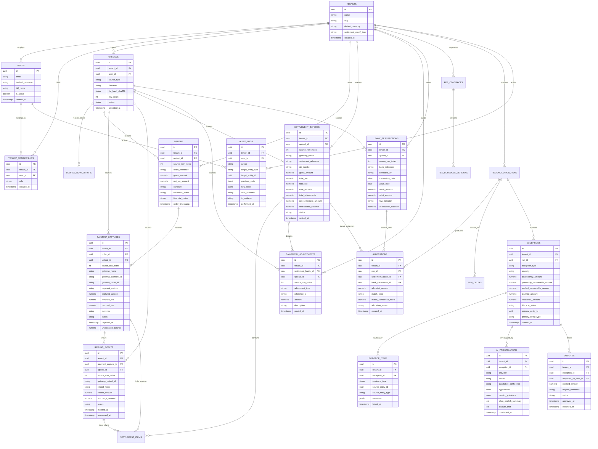

# Finora — AI-Powered Financial Reconciliation & Revenue Leakage Engine
# Document 03: Updated Database Schema & Entity-Relationship Architecture

**Project Name:** Finora  
**Document Reference:** FINORA-DB-ERD-V2  
**Classification:** Database Architecture Specification  
**Author:** PostgreSQL Database Architect, Principal Software Architect  
**Status:** Under Formal Architectural Review (Phase 0)  
**Date:** November 2026  

---

## 1. Executive Summary & Design Philosophy

The database design of Finora enforces five non-negotiable architectural mandates:

1. **PostgreSQL as Authoritative Source of Truth:** Redis is used solely for worker coordination and distributed locks. Every financial state, allocation, and audit log is persisted in PostgreSQL with strict relational integrity.
2. **Arbitrary Precision for Financial Balances:** Zero floating-point columns. All monetary balances, allocations, fees, and rates use `NUMERIC(18, 4)` (or `NUMERIC(8, 6)` for fractional percentage rates).
3. **Tenant Boundary Enforcement:** Every table contains an indexed `tenant_id` foreign key. Row-Level Security (RLS) policies and composite unique constraints enforce absolute tenant isolation.
4. **Immutable Append-Only Audit & Allocation Ledger:** Allocations, run deltas, and audit entries are immutable. State changes are recorded as new rows or version transitions (`ACTIVE` vs `SUPERSEDED`).
5. **Full Provenance & Lineage:** Every normalized financial record references `upload_id` and `source_row_index` to trace directly back to the physical source CSV.

---

## 2. Updated Entity-Relationship Diagram (Mermaid)



---

## 3. Detailed Entity Definitions & Technical Design Choices

### 3.1 Resolving Prior Missing Entities
In this revised schema, we have explicitly introduced four essential entities that were missing from the initial design:
1. **`CANONICAL_ADJUSTMENTS`:** Captures chargebacks, dispute fees (e.g. ₹500 + GST), reserve withholdings, and gateway billing corrections. This bridges the gap between gross captures and net bank credits.
2. **`SETTLEMENT_ITEMS`:** Bridges individual captures and refunds to their parent settlement batch, tracking line-item level settlement fulfillment.
3. **`SOURCE_ROW_ERRORS`:** Quarantines malformed or unmappable CSV rows during ingestion without halting the pipeline, recording exact line numbers and parse failures.
4. **`RUN_DELTAS`:** Stores the exact mathematical diff between consecutive reconciliation runs (newly matched, broken matches, new exceptions).

### 3.2 Allocation Invariant & Concurrency Control
```sql
-- Enforcing non-negative unallocated balance at database level
ALTER TABLE bank_transactions 
ADD CONSTRAINT chk_bank_tx_unallocated_non_negative 
CHECK (unallocated_balance >= 0);

ALTER TABLE settlement_batches 
ADD CONSTRAINT chk_settlement_unallocated_non_negative 
CHECK (unallocated_balance >= 0);

-- Composite Unique Index to prevent duplicate active allocations
CREATE UNIQUE INDEX uq_active_allocations 
ON allocations (tenant_id, settlement_batch_id, bank_transaction_id) 
WHERE allocation_status = 'ACTIVE';
```

During execution of reconciliation passes, affected rows in `settlement_batches` and `bank_transactions` are locked using:
```sql
SELECT id, unallocated_balance 
FROM bank_transactions 
WHERE id = :bank_tx_id AND tenant_id = :tenant_id 
FOR UPDATE;
```
This guarantees that concurrent background workers or reruns can never execute simultaneous competing allocations.

---

## 4. Tenant Isolation Strategy

### 4.1 Row-Level Security (RLS) Architecture
Every query executed by the application sets the PostgreSQL session configuration variable:
```sql
SET LOCAL app.current_tenant_id = 'c4b8e21a-...';
```
PostgreSQL Row-Level Security policy on all financial tables:
```sql
CREATE POLICY tenant_isolation_policy ON orders
FOR ALL
USING (tenant_id = NULLIF(current_setting('app.current_tenant_id', true), '')::uuid);
```
Even in the event of an application-level bug or missed `WHERE` clause, the database kernel strictly forbids cross-tenant data leakage.

---
*(End of Document 03 — Updated Database Schema & ER Architecture)*
