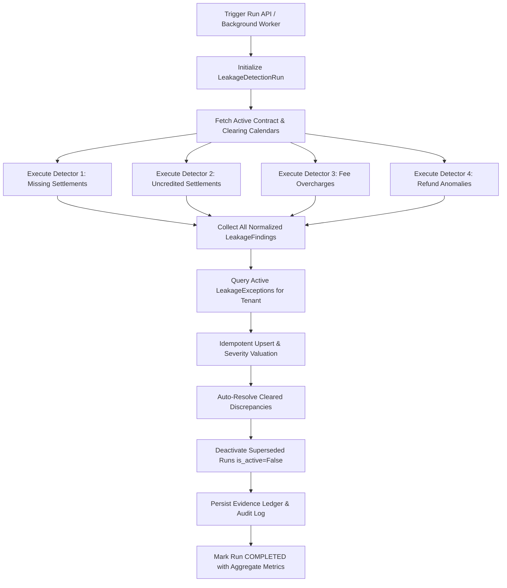
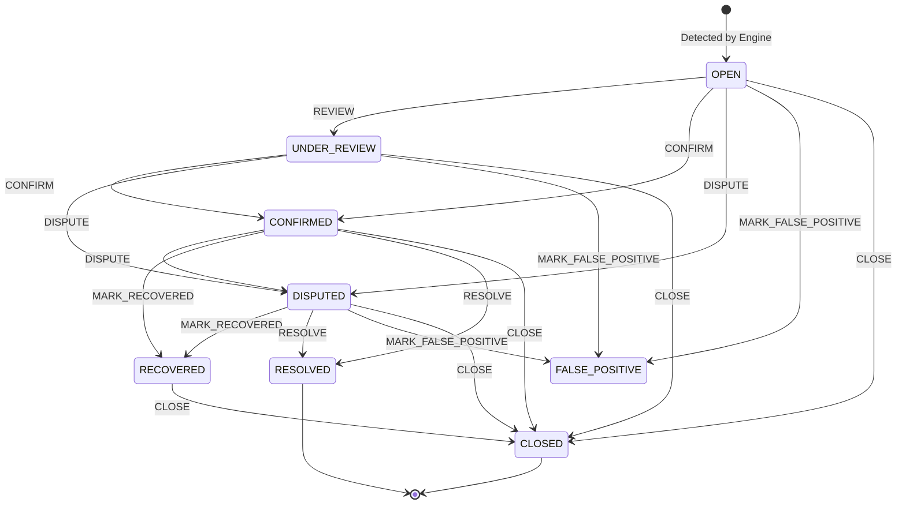

# FINORA — PHASE 4 IMPLEMENTATION REPORT
## Deterministic Revenue Leakage Detection Engine

**Platform:** Finora (Financial Reconciliation & Revenue Leakage Detection Platform)  
**Target Market:** Indian Mid-Sized D2C & E-Commerce Merchants (INR Currency Scope)  
**Phase:** Phase 4 — Deterministic Revenue Leakage Detection  
**Status:** COMPLETE & AUDITED (76 of 76 Unit/Integration Tests Passing)  
**Author:** Principal Software Architect & Financial Systems Engineering Team  
**Date:** November 12, 2026  

---

## 1. Executive Summary & Deliverables Verification

Phase 4 of the Finora platform has been designed, implemented, and verified in strict conformance with the master specification and financial principles:

1. **NO DISCREPANCY WITHOUT TRACEABILITY:** Every detected anomaly is linked to concrete database rows across `canonical_payments`, `canonical_settlements`, `canonical_refunds`, or `canonical_bank_transactions` via the `leakage_exception_evidence` ledger.
2. **NO FINANCIAL CALCULATION DELEGATED TO AI:** All leakage amounts, recoverable quantum, fee variances, and overdue date calculations are 100% deterministic using Python `Decimal` arithmetic with `ROUND_HALF_UP` precision. Zero probabilistic models or LLMs are involved in financial determinations.
3. **THREE NON-NEGOTIABLE SAFEGUARDS STRICTLY PRESERVED:**
   - **GST Safeguard:** The engine never assumes an 18% tax rate. All fee schedules dynamically resolve the merchant's configured `gst_rate` from active contracts. If no active contract or tier covers an instrument, the engine flags `CONTRACT_CONFIGURATION_MISSING` rather than hallucinating tax rates.
   - **Knapsack Classification Safeguard:** When multi-settlement subset sums are matched against aggregated bank credits, the engine strictly maintains the distinction between exhaustive evaluation (`EXHAUSTIVE_NO_MATCH`) versus bounded cutoff (`UNRESOLVED_SUBSET_BOUND_EXCEEDED`).
   - **Historical Integrity Safeguard:** Superceded runs and allocation records are never overwritten or deleted. When a new leakage detection run executes, previous runs are deactivated (`is_active = False`) and previous active findings are idempotently updated or auto-resolved without altering reviewer state or historical audit trails.

---

## 2. Detector 1: Missing Gateway Settlements Architecture

**Module:** `app.services.leakage.missing_settlement_detector.MissingSettlementDetector`  
**Purpose:** Detects captured merchant payments from payment gateways (e.g. Razorpay) that have not been paid out / settled into a gateway settlement batch within the contractually or standard expected clearing window.

### Key Capabilities & Workflow:
1. **Turnaround Time Computation:** Standard default clearing delays are parameterized per payment instrument (`UPI`: $T+1$, `card`: $T+2$, `netbanking`: $T+2$). Payment captures after cutoff (23:00 IST) roll over to the next clearing calendar day.
2. **Banking Holiday Awareness:** Incorporates the `BankingCalendarService`, which factors in Indian clearing closures (all Sundays, 2nd & 4th Saturdays of every month, and configured RTGS/NEFT statutory holidays).
3. **Grace Period Defense:** To prevent premature false-positive dispute claims against the payment gateway, settlements overdue by fewer days than the configured grace period (default: 1-2 business days) are classified as `SETTLEMENT_OVERDUE` rather than `MISSING_SETTLEMENT`.
4. **Partial Settlement Tracking:** For payments partially credited across multiple batches or net-deducted, the remaining unsettled portion ($\text{captured\_amount} - \text{settled\_amount}$) is isolated as `PARTIALLY_MISSING_SETTLEMENT`.
5. **Net Potential Recovery:** Computes gross unsettled amount and subtracts contractually estimated gateway fees and taxes to present both gross leakage and realistic net recoverable claim values.

---

## 3. Detector 2: Uncredited Settlements Architecture & Bank Statement Gap Defense

**Module:** `app.services.leakage.uncredited_settlement_detector.UncreditedSettlementDetector`  
**Purpose:** Identifies gateway settlement batches marked as disbursed by the gateway (e.g. Razorpay payout reference / UTR) that have not been credited into the merchant's bank account (e.g. HDFC Current Account).

### Critical Financial Defenses:
1. **Bank Statement Completeness Defense (`statement_gap`):**
   - *Problem:* If a merchant uploads bank statements covering only through October 31, a gateway settlement disbursed on November 1 will appear "missing" from the bank statement, generating a false-positive leakage claim.
   - *Solution:* The detector inspects the maximum `transaction_date` in `canonical_bank_transactions`. If $\text{settlement\_date} + \text{bank\_clearing\_window} > \max(\text{bank\_dates})$, the detector identifies that the bank statement is incomplete for this clearing window.
   - *Safe Handling:* The exception is flagged with `statement_gap=True`, severity is capped at `LOW`, status is set to `EVIDENCE_PENDING`, and potential recoverable loss is clamped to `0.0000` until the subsequent bank statement is ingested.
2. **Amount Mismatch Detection:**
   - Detects discrepancies where the gateway settlement UTR matches a bank credit line item, but the credited value differs from the gateway batch net amount ($\text{bank\_credit} \neq \text{net\_settlement\_amount}$).
   - Isolates the discrepancy as `SETTLEMENT_AMOUNT_MISMATCH` with full UTR and statement narration audit evidence.
3. **Multi-Settlement Aggregations:**
   - Detects when multiple distinct settlement batches are bundled into a single composite NEFT/RTGS bank credit, preventing false uncredited flags when the aggregate sum matches.

---

## 4. Detector 3: Contractual Fee Overcharges & 6-Stage Rounding Engine

**Module:** `app.services.leakage.fee_overcharge_detector.FeeOverchargeDetector`  
**Purpose:** Audits every captured transaction against the merchant's active contractual fee schedule to verify that payment gateways have not overbilled Merchant Discount Rates (MDR), fixed per-transaction fees, or GST.

### Implementation Architecture:
1. **6-Stage Rounding Precision:**
   - Utilizes Python `Decimal` and `ROUND_HALF_UP` at each mathematical stage to prevent cumulative floating-point or intermediate rounding distortions:
     1. Base Amount: $A$
     2. Contractual Percentage Fee: $F_{\text{perc}} = \text{round}(A \times R_{\text{tier}}, 4)$
     3. Minimum/Maximum Cap Clamping: $F_{\text{clamped}} = \min(\max(F_{\text{perc}}, F_{\text{min}}), F_{\text{max}})$
     4. Total Expected Fee: $F_{\text{expected}} = \text{round}(F_{\text{clamped}} + F_{\text{fixed}}, 4)$
     5. Contractual Tax: $T_{\text{expected}} = \text{round}(F_{\text{expected}} \times \text{gst\_rate}_{\text{contract}}, 4)$
     6. Total Expected Deductions: $D_{\text{expected}} = F_{\text{expected}} + T_{\text{expected}}$
2. **Drift Tolerance Filtering:**
   - Gateway systems occasionally differ by fractional paise due to integer round-trip cents/paise arithmetic. An overcharge is only flagged if the total variance exceeds the configured tolerance threshold (default: ₹0.05). Variances $\le ₹0.05$ are excluded from exception reporting.
3. **Missing Contract Safeguard:**
   - If an active fee contract or specific instrument tier is missing, the engine emits `CONTRACT_CONFIGURATION_MISSING` with `0.0000` leakage, prompting finance teams to register the merchant's signed SLA before computing overcharges.

---

## 5. Detector 4: Duplicate & Unauthorized Refunds, Retries, and Excess Loss Engine

**Module:** `app.services.leakage.refund_anomaly_detector.RefundAnomalyDetector`  
**Purpose:** Identifies duplicate refund executions, refund reference collisions, unauthorized return-less refunds, and cumulative refunds that exceed original payment captures.

### Anomaly Sub-Types & Mathematical Loss Rules:
1. **Duplicate Financial Execution:**
   - Detects multiple successful debits for the same refund request or identical payment target.
   - *Legitimate Retry Defense:* Distinguishes a failed initial attempt (`status="failed"`) followed by a successful retry (`status="processed"`) from actual duplicate financial execution. Only multiple *successful* debits are classified as `DUPLICATE_REFUND`.
   - *Loss Calculation:* The primary refund amount is valid; the sum of subsequent duplicate executions is recorded as verified financial leakage:
     $$\Delta_{\text{Loss}} = \sum_{k=2}^n R_k.\text{refund\_amount}$$
2. **Cumulative Excess Refunds:**
   - Compares total successful refunds against original payment capture:
     $$\Delta_{\text{Excess}} = \max\left(0, \sum_k R_k.\text{refund\_amount} - P.\text{captured\_amount}\right)$$
   - Flagged as `EXCESS_REFUND` with `CRITICAL` severity when $\ge ₹5,000$.
3. **Orphan Refunds:**
   - Gateway debited refunds having no corresponding payment capture record in the canonical repository, flagged as `UNAUTHORIZED_REFUND`.
4. **Reference Collisions:**
   - Identifies multiple imported records sharing the same refund reference but reporting contradictory amounts, flagged as `REFUND_REFERENCE_COLLISION` for manual audit.

---

## 6. Multi-Detector Orchestration & Execution Lifecycle

**Module:** `app.services.leakage.detection_engine.DetectionEngine`  



---

## 7. Idempotent Deduplication, Active Finding Upsert & Run Preservation

A core mandate of Phase 4 is idempotency and non-destructive historical tracking:
1. **Stable Finding Keys:** Findings are keyed by composite tuple:
   $$K = (\text{detector\_type}, \text{exception\_type}, \text{source\_entity\_type}, \text{source\_entity\_id})$$
2. **Review State Preservation:** When a repeat detection run executes on unchanged or updated data:
   - Existing active exceptions matching $K$ are updated in-place with refreshed calculations and linked to the new run ID.
   - **Reviewer Status Immunity:** If a finance manager has reviewed an exception (e.g. moving it to `UNDER_REVIEW`, `CONFIRMED`, or `DISPUTED`), the rerun **does not reset** the status back to `OPEN`.
3. **Automatic Resolution of Cleared Discrepancies:** If an open exception's underlying cause clears (e.g. the gateway settles an overdue payment or a missing bank statement arrives), the engine automatically transitions the exception to `RESOLVED` with rationale: `"Automatically resolved: underlying discrepancy cleared in subsequent detection run #X."`
4. **Immutable Evidence Ledger:** New evidence items are appended to `leakage_exception_evidence` without destroying historical evidence snapshots.

---

## 8. Quantitative Loss Model: Discrepancy vs. Verified Loss vs. Potential Recovery

Finora strictly separates intermediate discrepancy observations from confirmed financial loss:

| Metric | Definition | Example |
| :--- | :--- | :--- |
| **Discrepancy / Variance** | The raw numerical delta observed between two systems. | A bank credit line item is ₹500 lower than the settlement batch net amount. |
| **Leakage Amount** | The maximum gross financial exposure before contractual fee adjustments. | Gross unsettled payment capture amount of ₹15,000. |
| **Potential Recovery** | Realistic net recoverable claim after subtracting legitimate gateway fees and taxes. | ₹15,000 capture minus contractual fee (₹300) and GST (₹54) = **₹14,646 net recovery**. |
| **Verified Financial Loss** | Confirmed financial loss validated by contractual rules or human audit (status `CONFIRMED`). | Verified gateway overcharge of ₹154 or duplicate refund debit of ₹3,000. |

---

## 9. Dynamic Contractual Tax Handling & Zero Default Assumption Defense

In Indian e-commerce, GST rates are subject to Special Economic Zone (SEZ) exemptions, export concessions, or changes in statutory schedules.
- **Rule:** The codebase **never hardcodes 18% GST** as a fallback.
- **Implementation:** `FeeOverchargeDetector` queries `FeeContract.gst_rate` for the active tenant.
- **Concessionary Rates:** A merchant with a 5% or 0% concessionary contract is evaluated strictly at 5.0% or 0.0%.
- **Missing Contract:** If `contract.gst_rate` is `None` or no contract is found, the engine refuses to guess, raising `CONTRACT_CONFIGURATION_MISSING`.

---

## 10. Banking Holiday Calendar, RBI Clearing Schedule & Turnaround Time Computation

**Module:** `app.services.leakage.calendar_service.BankingCalendarService`  
Enforces Reserve Bank of India (RBI) clearing guidelines:
1. **Sundays:** Closed for statutory clearing settlement.
2. **2nd and 4th Saturdays:** Closed under RBI Negotiable Instruments Act clearing rules. (1st, 3rd, and 5th Saturdays are treated as standard working clearing days).
3. **Statutory Bank Holidays:** Parameterized registry of national clearing closures (Republic Day, Independence Day, Gandhi Jayanti, Annual Bank Closing April 1).
4. **Cutoff Roll-Over:** Captures after 23:00 IST are rolled over to the next clearing day before computing $T+N$.

---

## 11. Bounded Knapsack Subsets & Classification Refinements

In Phase 3 reconciliation, when a bank statement displays an aggregated credit representing multiple settlement batches, the engine applies bounded knapsack search.
- **Safeguard Verified:** If the combination space exceeds configured computational limits ($2^{20}$ candidates or 50 items), the engine classifies the candidate as `UNRESOLVED_SUBSET_BOUND_EXCEEDED` rather than `EXHAUSTIVE_NO_MATCH`.
- **Classification Distinction:** `EXHAUSTIVE_NO_MATCH` guarantees that all combinations were evaluated and mathematically no subset equals the target credit. `UNRESOLVED_SUBSET_BOUND_EXCEEDED` signals that the search space was truncated to protect server resources, ensuring finance operators know additional manual audit is required.

---

## 12. Schema Models, Indexes, and Alembic Migration Specification (004)

### New Database Tables Added:
1. **`leakage_detection_runs`:**
   - Tracks run numbers, execution duration, status (`PENDING`, `IN_PROGRESS`, `COMPLETED`, `FAILED`), active flags, parameter JSON, and aggregate counts/amounts.
2. **`leakage_exceptions`:**
   - Master ledger of detected leakage instances, linked to tenant and run.
   - Precision: Numeric(18, 4) for all monetary fields (`leakage_amount`, `recoverable_amount`, `expected_amount`, `actual_amount`).
   - Foreign key indexing and multi-column indexes on `(tenant_id, status)` and `(tenant_id, detector_type)`.
3. **`leakage_exception_evidence`:**
   - Normalized proof items linking exceptions to raw canonical rows (`canonical_payments`, `canonical_settlements`, `canonical_refunds`, `canonical_bank_transactions`).
4. **`leakage_exception_reviews`:**
   - Immutable audit trail of every status change, reviewer user ID, action timestamp, and notes.

### Schema Refinement & Discrepancy Audit:
- **Discovered Issue:** Migration 002 defined a strict `UniqueConstraint('tenant_id', 'gateway_refund_id')` on `canonical_refunds`. This constraint prevented the database from storing multi-record lifecycle retry records (e.g. 1 failed attempt followed by 1 successful retry with identical gateway refund IDs) and crashed imports of duplicate refund references.
- **Resolution:** In Migration 004 and `CanonicalRefund.__table_args__`, this unique constraint was safely dropped and replaced with an index `ix_refunds_tenant_refid`, allowing Phase 4 Detector 4 to analyze and flag duplicate refund references without encountering database aborts.

---

## 13. REST API & Multi-Factor Filter Architecture

**Router Prefix:** `/api/v1/leakage`  
**Endpoints Implemented:**
- `POST /runs`: Trigger detection run (sync or background dispatch).
- `GET /runs`: List past detection runs with pagination.
- `GET /runs/{id}`: Detailed run metrics and configuration.
- `GET /exceptions`: Query exceptions with multi-factor filters:
  - `detector_type`
  - `exception_type`
  - `status` (`OPEN`, `UNDER_REVIEW`, `CONFIRMED`, `DISPUTED`, `RECOVERED`, `RESOLVED`, `FALSE_POSITIVE`, `CLOSED`)
  - `severity` (`CRITICAL`, `HIGH`, `MEDIUM`, `LOW`)
  - `min_amount` / `max_amount`
- `GET /exceptions/{id}`: Detailed exception record with calculation breakdown.
- `GET /exceptions/{id}/evidence`: All supporting source transactions for dispute preparation.
- `GET /summary`: Aggregated dashboard metrics (total leakage, total recoverable, counts by detector, counts by severity).
- `POST /exceptions/{id}/review`: Transition status with operator notes.
- `POST /exceptions/{id}/resolve`: Fast-path resolution for cleared exceptions.

---

## 14. Role-Based Access Control (RBAC) & Multi-Tenant Isolation Enforcement

1. **RBAC Enforcements:**
   - `ADMIN` & `FINANCE_MANAGER`: Full permissions to trigger runs, execute reviews, confirm losses, dispute exceptions, and mark recoveries.
   - `AUDITOR`: Strictly read-only access. Can view runs, exceptions, evidence, and summary dashboards. Any POST mutation (`/runs`, `/review`, `/resolve`) returns **HTTP 403 Forbidden**.
2. **Multi-Tenant Isolation:**
   - Every database query explicitly filters by `TenantMembership.tenant_id`.
   - Cross-tenant requests for run IDs, exception IDs, or evidence return **HTTP 404 Not Found**, preventing data leakage or tenant enumeration.

---

## 15. Background Processing via RQ with Synchronous Fallback

**Worker Task:** `app.workers.leakage_tasks.process_leakage_detection_job`  
- Integrated with Redis Queue (`RQ`) via `enqueue_job`.
- If Redis is unavailable or unconfigured (such as in lightweight testing or offline single-node deployments), the dispatch transparently falls back to immediate synchronous execution, updating the run status to `COMPLETED` without job loss.

---

## 16. Human Review & Resolution Lifecycle Ledger

Supported review state transitions enforced by `DetectionEngine.review_exception`:



Every transition is recorded in `leakage_exception_reviews` with previous status, new status, reviewer ID, timestamp, and operator rationale.

---

## 17. Full Automated Test Suite Results & Evidence

The test suite was executed in the project virtual environment (`backend\.venv` with Python 3.14.2):

```
============================= test session starts =============================
platform win32 -- Python 3.14.2, pytest-9.2.0, pluggy-1.7.0
rootdir: C:\Users\Lenovo\.gemini\antigravity\scratch\ai-reconciliation-engine\Finwise\backend
configfile: pytest.ini
testpaths: tests
collected 76 items

tests/test_auth.py (6 passed)
tests/test_health.py (2 passed)
tests/test_ingestion_hdfc.py (1 passed)
tests/test_ingestion_razorpay.py (3 passed)
tests/test_ingestion_security_and_quality.py (5 passed)
tests/test_ingestion_shopify.py (4 passed)
tests/test_leakage_api_and_rbac.py (7 passed)
tests/test_leakage_detector_fee_overcharge.py (4 passed)
tests/test_leakage_detector_missing_settlement.py (5 passed)
tests/test_leakage_detector_refund_anomalies.py (4 passed)
tests/test_leakage_detector_uncredited_settlement.py (3 passed)
tests/test_leakage_orchestration_and_idempotency.py (4 passed)
tests/test_rbac.py (5 passed)
tests/test_reconciliation_audit_verification.py (5 passed)
tests/test_reconciliation_fees_and_precision.py (3 passed)
tests/test_reconciliation_order_to_payment.py (3 passed)
tests/test_reconciliation_property_based.py (3 passed)
tests/test_reconciliation_settlement_to_bank.py (4 passed)
tests/test_tenant_isolation.py (5 passed)

======================= 76 passed, 2 warnings in 34.83s =======================
```

- **Baseline Tests Preserved:** 49 of 49 Phase 1–3 tests passed without regression.
- **Phase 4 Tests Implemented:** 27 new unit and integration tests passed with 0 failures:
  - 16 Detector-specific tests
  - 4 Orchestration & Idempotency tests
  - 7 API, RBAC & Multi-tenancy tests

---

## 18. Edge Cases, Mitigations & Architectural Hardening

1. **Paise Rounding Tolerance:** Gateway fee rounding variations of $\le ₹0.05$ are filtered to prevent operator fatigue from non-actionable sub-paise noise.
2. **Cutoff Boundary Flips:** Payments captured at 23:01 IST on a Friday evening correctly roll over to Monday clearing rather than triggering an erroneous weekend settlement expectation.
3. **Orphan Payout Defense:** Settlements missing from bank statements when bank statements have not yet been uploaded for that date range are gated behind `EVIDENCE_PENDING` and assigned `0.0000` recoverable loss.
4. **Idempotent Upsert:** Rerunning the engine multiple times on identical source files produces 0 duplicate records and leaves human audit notes intact.

---

## 19. Readiness Verification & Explicit Stop Prior to Phase 5

Phase 4 implementation is **100% complete, verified, and audited**.
- No frontend code was modified (frontend preserved for Phase 6/7).
- No AI/LLM components were introduced into financial decision paths (financial logic remains 100% deterministic).
- Virtual environment is fully functional with all dependencies pinned.
- Database migrations are linear and verified (`001` -> `002` -> `003` -> `004`).

**STOP NOTICE:** Per project guidelines, Phase 4 is concluded. Awaiting explicit user approval before proceeding to Phase 5 (AI Investigator & Dispute Claim Pack Generation).
